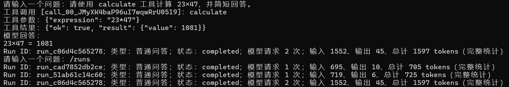
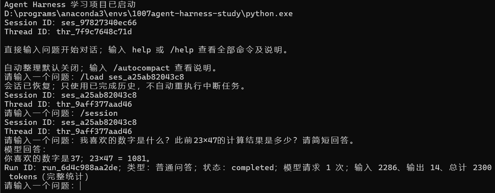
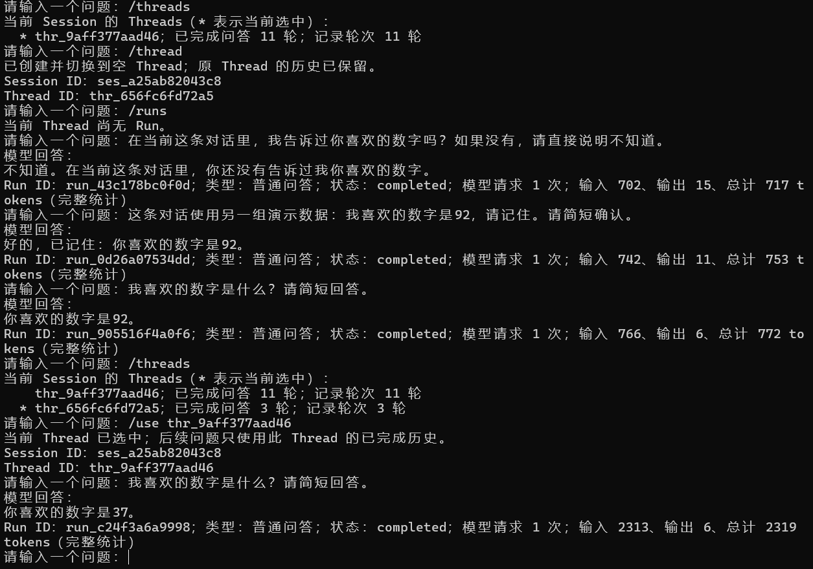
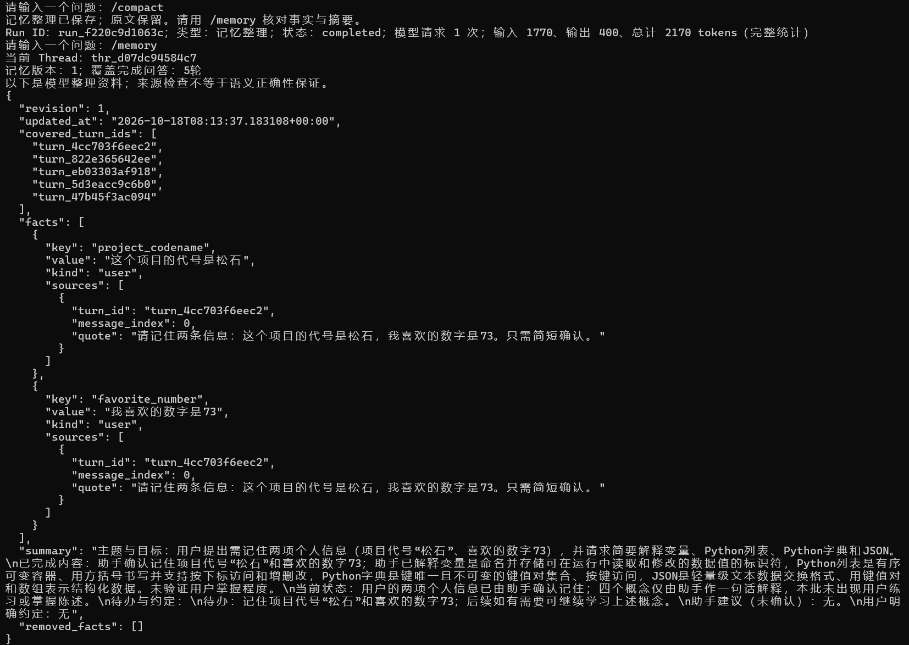
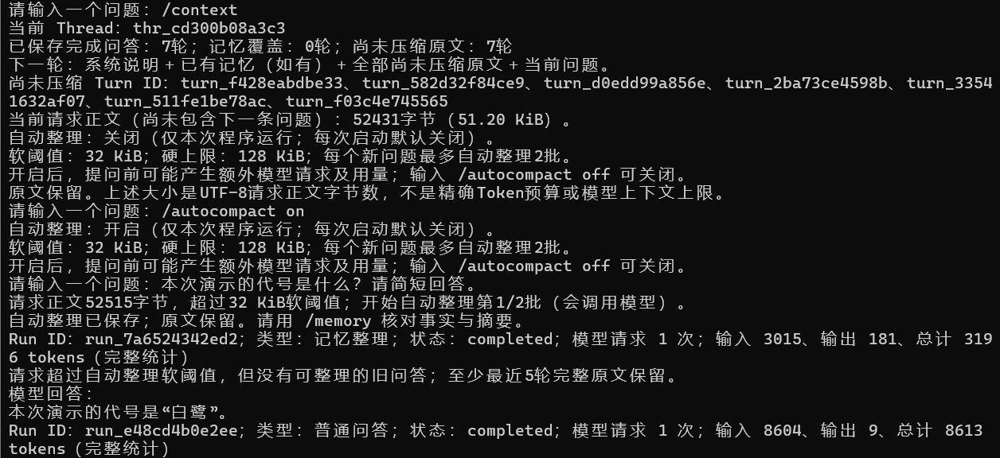

# Agent Harness Lab

一个使用 Python 标准库逐步构建的命令行 Agent Harness。配置自己的 DeepSeek API，在终端与 Agent 连续对话，观察工具调用、执行记录、会话恢复和上下文整理如何配合。

**运行入口：`python -X utf8 main.py`。** 从输入第一条问题开始，所有操作都在命令行完成。项目的开发过程也沿着这条路径逐阶段验证，目标是把一次回答背后的组织、执行和保存过程讲清楚。

- [快速开始](#快速开始)：配置自己的接口并启动程序。
- [真实运行截图](#真实运行截图)：查看工具、恢复、隔离与记忆整理的实际结果。
- [动手体验](#动手体验)：工具、执行追踪、恢复、Thread 和记忆。
- [命令速查](#命令速查)：输入 `help` 时也能在程序里查看。
- [开发历程](docs/development.md)：每一步的问题、选择与实际输出。
- [架构说明](docs/architecture.md)：请求协议、数据结构和失败边界。

## 一次真实运行节选

以下来自开发期间的真实终端记录，省略执行编号。

```text
请输入一个问题：请使用 calculate 工具计算 23×47。
工具调用 [省略调用编号]：calculate
工具参数：{"expression": "23*47"}
工具结果：{"ok": true, "result": {"value": 1081}}
模型回答：
23×47 = 1081
请输入一个问题：刚才的计算结果是多少？
模型回答：
刚才 23×47 的计算结果是 **1081**。
```

模型决定请求哪个工具，程序检查名称和参数后执行，再把结果交回模型。工具执行与最终回答都进入同一轮记录；输入 `/trace` 可以检查过程。

## 真实运行截图

以下截图由开发者使用真实接口、从命令行逐步运行采集。数字与代号是演示数据，天气和时间只对应截图中的查询时刻。完整的 19 张截图、复现步骤和证据说明见[命令行演示记录](docs/development.md#phase-54命令行演示与截图证据)。

**工具调用与执行记录。** 输入计算问题，模型请求 `calculate`，程序返回 `1081`，模型再组织最终回答。这一轮实际记录了两个模型请求，接口报告总用量为 1,597 tokens；三步详情见[执行追踪截图](截图/04-计算任务执行追踪与接口用量.png)。



**退出重启后恢复原会话**

启动默认创建新会话，明确加载旧 Session 后，再次回答出原来的数字 `37` 和计算结果 `1081`。



**Thread 独立历史：新对话记住92，原对话保留37**

新 Thread 最初没有 Run，也不知道数字偏好；记录 `92` 后切回原 Thread，仍回答 `37`。图中保留了实际切换命令和不同的 Thread ID。



**手动整理：重要事实、滚动摘要与原文来源**

十轮简短问答后，`/compact` 覆盖前五轮，保留后五轮完整原文。`/memory` 展示项目代号“松石”、数字 `73` 及对应 Turn、消息索引和引文，整理后仍能回忆这些信息。此例摘要比原来的简短问答更长，请求正文从 4,957 增至 5,638 字节，不能作为缩小体积的例子。



[整理前上下文](截图/10-手动整理前的十轮问答与上下文.png) · [整理后覆盖范围](截图/12-手动整理后的上下文覆盖范围.png) · [整理后回忆结果](截图/13-手动整理后回忆项目代号与数字.png)

**自动整理：超过软阈值后执行，保留近期完整问答**

用独立演示会话和明确标记的重复文本测试阈值。开启自动整理后，下一个问题的请求正文为 52,515 字节，触发一次整理；程序保存覆盖两轮的记忆，再回答出代号“白鹭”。没有可继续整理的旧问答时，保留最近五轮原文，不强行降到软阈值以下。



[自动整理的事实来源](截图/17-自动整理生成的事实摘要与来源.png) · [上下文、Run 与关闭开关](截图/18-自动整理后的上下文运行记录与关闭开关.png)

## 快速开始

### 1. 准备 Python，进入项目目录

已验证环境为 Windows、PowerShell、Python 3.12.15，推荐 Python 3.12。项目只使用标准库，无需安装第三方 Python 包；Anaconda 不是必要条件。

从 GitHub 下载并解压项目，或克隆仓库后，进入包含 `main.py` 的目录，再检查解释器：

```powershell
python --version
python -c "import sys; print(sys.executable)"
```

每个人的下载目录和解释器位置可以不同，如果当前终端找不到 `python`，可以激活自己的 Conda 环境，或使用自己 Python 的完整路径。

### 2. 填写自己的 API 配置

首次配置时复制模板，以下命令保留已有 `.env`：

```powershell
if (-not (Test-Path -LiteralPath .env)) {
    Copy-Item -LiteralPath .env.example -Destination .env
}
```

在本机编辑 `.env`，用 UTF-8 保存三个非空配置。下面只是占位示例：

```dotenv
DEEPSEEK_API_KEY=<填写自己的密钥>
DEEPSEEK_MODEL=<当前可用且兼容工具调用的模型名称>
AGENT_SYSTEM_PROMPT=你是一位耐心、准确的中文助手。
```

模板的密钥栏留空。复制后尚未填写密钥就启动时，程序会提示缺少 `DEEPSEEK_API_KEY` 并退出，这是配置检查的正常结果。填写自己的密钥并确认模型、系统说明后再运行。配置字段齐全只代表可以尝试请求；首次普通提问才会实际验证接口。

模型名称请从 [DeepSeek 官方文档](https://api-docs.deepseek.com/)确认。程序使用 `https://api.deepseek.com/chat/completions`，真实问答与记忆整理可能产生接口费用。不要公开真实密钥、私人会话或终端中意外包含的个人信息。

也可在启动程序的终端设置三个同名环境变量。非空环境变量优先，但程序仍解析已有 `.env`。文件支持空行、整行 `#` 注释、`KEY=value` 和成对引号；不支持 `export`、变量插值、重复字段、额外配置名称或行尾注释。

### 3. 启动命令行 Agent

在项目目录执行：

```powershell
python -X utf8 main.py
```

`-X utf8` 启用 UTF-8，帮助在 Windows 终端正确处理中文。启动后会显示实际解释器、Session ID、Thread ID 和简短提示；第一次启动会创建自己的空会话。

在“请输入一个问题”后输入：

```text
help
```

程序会展开全部命令及解释。直接输入普通问题即可连续对话；输入 `exit` 结束。`help`、空输入和退出命令不会发送给模型。

## 动手体验

### 工具与执行记录

以下内容逐条输入在程序的问题提示后，不要一次粘贴整段：

```text
我喜欢的数字是37，请记住。
我喜欢的数字是什么？请简短回答。
请使用 calculate 工具计算 23×47。
/runs
/trace
```

检查计算工具的结果 `1081`，以及追问是否使用了当前历史。这里紧接计算任务输入 `/trace`，查看的就是计算那一轮；如果中间已问过其他问题，从 `/runs` 复制计算任务的完整 Run ID，再输入 `/trace RunID`。

一次用户问题对应一个普通问答 Run。工具闭环通常包含“模型请求→工具执行→模型请求”三个 Step，因此一个 Run 可能请求模型多次。用量来自接口实际返回的数据，未知不等于零，部分统计只表示已知小计。

也可以试：

```text
请使用 get_time 查询运行程序的电脑当前时间。
请使用 get_weather 查询深圳, 广东, 中国的当前天气。
```

时间工具只查本机时间。天气工具访问 Open-Meteo；同名地点可能需要继续对话确认。天气是当前气象模型数据，不是未来天气查询或气象站即时实测。实际工具选择和文字回答由模型决定。

### 退出后恢复原对话

先输入 `/session`，记下完整的 `ses_` 编号，然后输入 `exit`。重新运行 `python -X utf8 main.py` 后，程序默认创建新会话；输入 `/load SessionID`，把占位词换成刚才记下的旧编号，再追问原来的数字和计算结果。

加载只恢复已保存资料，不会重新执行旧模型请求或工具。`/new` 创建新的空 Session，旧文件保留。

### 在一个 Session 中切换独立对话

输入 `/threads` 记下当前 Thread ID；用 `/thread` 新建空 Thread，告诉它“我喜欢的数字是92”。再用 `/use ThreadID` 切回原 Thread，核对原来的 `37`。每条 Thread 的历史、运行记录和记忆相互隔离，不能只凭模型偶然答对就判断隔离成功。

### 整理较早历史

先在同一个 Thread 完成至少六轮问答，再输入：

```text
/context
/compact
/memory
/context
/runs
```

`/compact` 会额外请求模型，整理重要事实和滚动摘要，每批最多五轮，至少保留最近五轮完整原文。`/memory` 显示实际生效的记忆和引文来源；`/context` 显示后续请求使用的范围。磁盘仍保留完整原文。

自动整理默认关闭。输入 `/autocompact on` 后，新问题的请求正文超过 32 KiB 时才尝试整理，每题最多两批；输入 `/autocompact off` 关闭。大小是 UTF-8 请求字节数，不是精确 Token 预算。摘要可能有遗漏或误解，需要核对来源。

## 命令速查

下列命令输入在程序的问题提示后。ID 占位词都需要替换为程序显示的完整编号。

| 命令 | 作用 |
| --- | --- |
| `help`、`/help` | 展开全部命令与说明 |
| `/session` | 查看当前 Session 和 Thread ID |
| `/new`、`/load SessionID` | 新建或恢复会话 |
| `/thread` | 创建并切换到空 Thread |
| `/threads`、`/use ThreadID` | 列出或切换当前 Session 的 Thread |
| `/runs` | 查看当前 Thread 的运行状态与接口用量 |
| `/trace`、`/trace RunID` | 查看最近一次或指定 Run 的步骤与事件 |
| `/compact` | 调用模型整理较早历史 |
| `/memory`、`/context` | 查看记忆来源、摘要及请求上下文范围 |
| `/autocompact` | 查看自动整理开关和限制 |
| `/autocompact on`、`/autocompact off` | 开启或关闭本次运行的自动整理 |
| `exit`、`quit`、`/exit` | 退出程序，保留已保存历史 |

`/compact` 会请求模型，其他列出的本地命令不请求模型。开启自动整理后，普通问题开始前可能额外请求整理。启动和切换会话不主动调用模型。

退出回到 `PS ...>` 后，才输入 PowerShell 的 `$LASTEXITCODE` 查看退出码；在“请输入一个问题”后输入它会成为模型问题。正常退出为 `0`，配置或保存失败通常为 `1`，用户取消为 `130`。


## 实现与边界

```text
main.py                命令行入口、配置、模型传输、工具循环与自动整理
tools.py               工具 Schema、参数检查、计算/时间/天气实现
harness.py             Session、Thread、执行记录、持久化与记忆管理
test_harness.py        标准库 unittest 离线验收
.env.example           占位配置模板
.gitignore             忽略本地配置、私人会话、归档与缓存
docs/development.md    阶段目标、方案选择、真实输出与验证证据
docs/architecture.md   协议、结构和失败边界
截图/                 19张按顺序命名的真实命令行运行截图
```

- 普通问答最多六次模型请求，每个响应最多八个工具调用。模型请求超时 30 秒；问答输出上限为 512 tokens，整理为 2048；截断回答不提交为有效完成。
- 计算使用 AST 白名单，不使用 `eval` 或 `exec`。三个工具都检查参数，不执行模型指定的任意代码或 Shell 命令。
- Session 保存在项目目录的 `sessions/`，会话格式版本为 4。失败轮不进入后续完成历史；中断任务恢复后不自动重执行。
- 同一 Session 只允许一个进程写入，当前没有跨进程锁。配置与会话路径按脚本目录定位。
- 每个模型请求受 128 KiB 请求正文硬上限约束；工具循环中不会随意切断工具协议或自动整理半轮消息。
- 来源校验不能保证模型理解正确。摘要扩大用户约定范围的问题仍待优化；没有精确历史检索或向量检索。


## 后续安排

- 已整理终端截图与可复现步骤，覆盖工具、恢复、追踪、隔离和记忆；短录屏可后续补充，目前未提供。
- 已用公开文件副本、干净环境变量完成首次下载流程模拟；使用已有 Python 3.12.15，未在新操作系统或新安装的 Python 上验证。下载副本已通过223项离线测试，退出码0。
- 已确定采用 MIT 许可证，并创建公开仓库；上传完成后验证 GitHub 页面展示和下载启动流程。

历史原文检索暂缓。

## 仓库与许可证

项目仓库：[brypom/agent-harness-lab](https://github.com/brypom/agent-harness-lab)。

本项目采用 [MIT 许可证](LICENSE)。

## 参考

- [DeepSeek API 文档](https://api-docs.deepseek.com/)：模型接口与工具协议。
- [Anthropic 上下文工程说明](https://www.anthropic.com/engineering/effective-context-engineering-for-ai-agents)：上下文选择、压缩与持久笔记。
- [Open-Meteo](https://open-meteo.com/en/docs)：天气服务与字段。
- [GitHub 忽略文件说明](https://docs.github.com/en/get-started/git-basics/ignoring-files)：忽略规则不会清除已提交历史。

