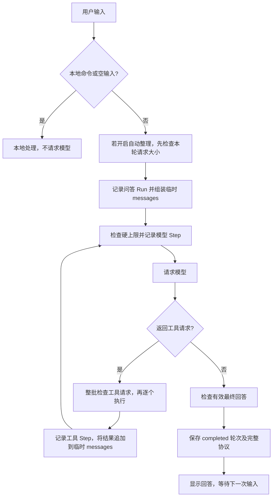

# 架构说明

[返回项目说明](../README.md) · [开发历程](development.md)

## 1. 三个核心边界

| 组件 | 负责什么 | 不负责什么 |
| --- | --- | --- |
| 模型与循环 | 组织请求、接收回答或工具调用、继续等待输入 | 模型输出不直接获得执行权限 |
| 工具 | 检查名称和参数，执行白名单函数，返回结构化结果 | 不执行模型指定的任意 Python、Shell 或文件操作 |
| Session | 保存原文、Thread、运行轨迹、记忆；提供请求所需上下文 | 已保存资料不必全部进入每次请求 |

`main.py` 是命令行入口和流程协调器，`tools.py` 保存工具定义与实现，`harness.py` 保存状态与持久化规则。公开项目通过终端展示模型循环、工具和会话三个组件的协作，没有第三方框架依赖、数据库或运行所需的网页服务。

## 2. 一轮问答的数据流



外层循环每次接收一个输入。内层工具循环属于同一轮问答，可以请求模型多次。模型给出有效最终回答后，一轮才可能完成；保存成功后，命令行才展示最终回答。

`run_turn()` 使用临时 `pending_messages`，避免模型失败时撤回已经污染的共享上下文。`run_saved_turn()` 的完成提交只保存本轮新增消息，不把发送用的旧记忆和历史重复写成一轮新原文。

如果请求、协议检查或模型回答失败，Run 结束为 `failed`，本轮已完成消息为空。此前的 Step 和用量仍留在运行记录中，后续请求不包含失败轮的半份消息。写盘失败立即停止；不在同一个失败存储上循环重试。

**实测对应。** [计算调用与运行概览](../截图/03-计算工具调用与运行概览.png)和[完整 Trace](../截图/04-计算任务执行追踪与接口用量.png)属于同一个 Run。Trace 中两个 `llm` Step 和一个 `tool` Step 均完成：第一步返回 `tool_calls`，第二步返回 `1081`，第三步生成回答；两次接口用量分别是 782 与 815 tokens，Run 汇总为 1,597。对应实现是 [main.run_turn()](../main.py#L308)、[tools.execute()](../tools.py#L273)与 [harness.run_saved_turn()](../harness.py#L1023)。

## 3. 模型请求与配置

`main.py` 启动时调用 `load_config()`：解析项目目录的 `.env`，再用非空环境变量覆盖同名值。配置名称只有：

```text
DEEPSEEK_API_KEY
DEEPSEEK_MODEL
AGENT_SYSTEM_PROMPT
```

系统说明由配置提示词与固定的工具使用说明组合，创建 Session 时一并保存。加载旧 Session 使用其保存的系统说明，而非悄悄换成当前配置提示词。

配置在本机命令行进程加载。缺少必要字段时给出中文提示并退出。启动、帮助、切换会话和查询本地运行记录不请求模型；普通问题、`/compact` 和开启后的自动整理才可能请求模型。程序不回显密钥，不将密钥或认证头写入运行记录。

`request_model()` 用 `urllib.request` POST JSON 到 `https://api.deepseek.com/chat/completions`，密钥仅用于构造认证头，不进入 Step 输入或保存的会话。模型名称由当前配置提供，不属于 Session 顶层配置字段；每个模型 Step 的请求正文会记录当次模型名称。

| 字段 | 普通问答 | 记忆整理 |
| --- | --- | --- |
| `messages` | system、记忆（如有）、全部未压缩完成问答、当前问题及本轮工具协议 | 整理规则和上一份记忆/本批原文 |
| `stream` | `false` | `false` |
| `thinking` | `{"type":"disabled"}` | 同左 |
| `max_tokens` | `512` | `2048` |
| `tools` / `tool_choice` | 已注册 Schema / `auto` | 不提供 |
| `response_format` | 不额外指定 | `{"type":"json_object"}` |

模型请求超时 30 秒；响应读取最多 1,000,000 字节，超过则拒绝。程序只接受正常结束的有效 assistant 消息；截断、空回答、无效结构不成为已完成问答。

`model_payload()` 的白名单正文同时用于传输和 Step 记录；`request_body()` 保证大小测量和传输采用相同 JSON/UTF-8 编码。

## 4. 工具协议

以下为协议说明示例，不是本次真实请求记录：

```json
{
  "role": "assistant",
  "content": null,
  "tool_calls": [
    {"id": "call_example", "type": "function", "function": {"name": "calculate", "arguments": "{\"expression\":\"23*47\"}"}}
  ]
}
```

```json
{
  "role": "tool",
  "tool_call_id": "call_example",
  "content": "{\"ok\":true,\"result\":{\"value\":1081}}"
}
```

assistant 调用与 tool 结果通过同一个调用 ID 对应，随后模型接收结果并生成最终文字回答。一个 assistant 批次可包含多个工具请求，结果顺序按批次执行顺序追加。

执行前先检查整个调用批次：类型、ID、名称、arguments 的字符串类型，以及本轮 ID 是否重复。协议不合法则整批不执行。已注册函数的参数内容通过 `tools.execute()` 的共享校验后执行；所有工具遵循相同的名称、JSON 和字段限制。工具级失败返回 `ok:false`，允许模型解释错误，而不是伪造成功数据。

| 工具 | 参数 | 实现及限制 |
| --- | --- | --- |
| `calculate` | 仅 `expression` 字符串 | AST 节点、深度、表达式长度、指数和数值范围白名单；支持有限算术和括号 |
| `get_time` | 空对象 `{}` | `datetime` 获取本地带偏移时间；多余参数也拒绝 |
| `get_weather` | 仅 `city` 字符串 | 地名服务再查询天气；多候选返回澄清结果，不擅自选择 |

普通问答最多六次模型请求；每次模型响应最多八个工具调用。第六次模型响应若继续请求工具，不执行新的工具批次，结束为失败。天气工具内部可能访问地名与天气两个端点，但它在执行轨迹中是一个工具 Step。

## 5. Session、Thread、Turn、Run、Step、Event

```text
Session（文件及配置快照）
└── Thread（历史与记忆的隔离范围）
    ├── memory（事实、摘要、覆盖范围）
    └── Turn（一次问答或整理任务）
        ├── messages（成功问答的本轮完整消息）
        ├── memory_update（成功整理的记忆快照）
        └── Run（本次执行）
            ├── Step（模型请求或工具执行）
            ├── Event（开始、用量、结束等事件）
            └── usage（模型 Step 用量汇总）
```

当前实现每个 Turn 对应一个 Run，没有在同一 Turn 内重新尝试多个 Run 的机制。命令行输入本地命令不创建问答 Turn；`/compact` 是会创建独立整理 Turn 的例外。自动整理也复用整理任务记录。

`/runs` 是目录式概览；`/trace` 是查看过程的命令；`/trace RunID` 选择指定执行。Trace 不是另一种会话，也不是给模型发送的历史。请求只使用问答消息与整理记忆，不发送全部事件或运行轨迹。

新建 Thread 保留 Session 的系统说明，新建空历史和空记忆。切换 Thread 不迁移其他 Thread 的问题、工具结果或摘要。加载 Session 恢复保存的当前 Thread。

**实测对应。** [Thread 切换截图](../截图/09-Thread创建切换与历史隔离.png)包含新 Thread 尚无 Run、写入 `92`、切回原 Thread 后回答 `37` 的过程。对应 [harness.new_thread()](../harness.py#L947)、[harness.use_thread()](../harness.py#L959)和 [harness.context()](../harness.py#L982)。截图是一次隔离行为观察，不能替代对组装请求和持久化结构的测试。

## 6. 保存与恢复

Session 保存到项目目录的 `sessions/<SessionID>.json`。`Store.save()` 先校验结构，写同目录临时文件，刷新并 `fsync`，关闭文件后通过 `os.replace` 替换目标快照。命令行只在本轮完成状态保存成功后显示最终回答。

Run/Step 开始、接口用量和完成结果会逐步保存，最后的回答只有保存成功后才展示。它提供恢复所需的状态记录，但不代表对外部操作有分布式事务保证。恢复时仍是 `running` 的 Run/Step 标记为 `interrupted`，不自动重放请求或工具。

当前会话结构版本为 `4`。加载版本 `1`、`2`、`3` 时，先校验并保留原始字节备份，再迁移结构；旧数据没有的轨迹或用量不能补造。历史问答保持原样，初始化空整理记忆。

当前没有跨进程文件锁，一个会话只允许一个进程写入。私人会话与备份都在忽略目录内，不属于公开示例。读取其他 Thread 的记录不会将它们加入当前请求历史。

**实测对应。** [退出前记录编号](../截图/07-查看会话编号并退出程序.png)与[重启后加载旧会话](../截图/08-重启程序并恢复历史会话.png)可对照同一个 Session 和 Thread。重新启动先创建新会话，`/load` 后选中旧记录，随后引用 `37` 和 `1081`。对应 [Store](../harness.py#L830) 的保存、加载及恢复规则；截图展示正常重启恢复，中断和写盘失败仍属于单独的测试范围。

## 7. 有来源的记忆与滚动摘要

`prepare_compaction()` 选择当前 Thread 最早、尚未覆盖的连续完成问答，每批最多五轮，至少留下最近五轮原文。失败/中断问答和整理任务不占完成问答名额。

模型收到 `previous_memory` 的事实/摘要和本批原文，返回 `facts`、`summary`、`removed_facts`。覆盖范围与版本由程序生成，不由模型决定。

- 每条事实有稳定 key、value、kind，以及 `turn_id`、消息索引、原文 quote。
- 用户事实需有用户原话来源；工具事实需有成功工具结果来源。来源只能来自当前 Thread 的合法已覆盖范围与本批原文。
- 新增、更新和撤回需有相应依据；本批没有新依据的有效旧用户事实复制保留原版本。
- 摘要分为主题与目标、已完成内容、当前状态、待办与约定。明确约定使用受校验的用户原话，助手建议单独标为未确认。
- 新记忆、覆盖范围与整理任务完成在同一个候选快照中提交。失败不先删除旧历史或替换有效记忆。

Step 保留模型原始候选输出，提交记忆可能按旧事实复制规则保留原版本。因此核对实际有效记忆用 `/memory`，检查生成过程用 `/trace`。引文检查及格式检查不能证明摘要的语义完全正确。

后续请求上下文是：

```text
系统说明
＋历史记忆资料（如有；标明不是当前用户请求或新系统指令）
＋全部尚未压缩的完整完成问答
＋当前问题
＋本轮工具调用和结果（如有）
```

不是“只保留最近五轮”：五轮是整理时的最低保留量，所有未压缩完整问答都会发送。近期纠正优先于旧记忆；当前时间和天气仍须重新使用工具。

**实测对应。** [整理前的十轮问答](../截图/10-手动整理前的十轮问答与上下文.png)、[生效记忆及来源](../截图/11-手动整理的重要事实摘要与来源.png)、[整理后覆盖范围](../截图/12-手动整理后的上下文覆盖范围.png)和[后续回忆](../截图/13-手动整理后回忆项目代号与数字.png)展示一次完整手动整理：总完成问答仍为十轮，前五轮被记忆覆盖，后五轮完整发送。对应 [prepare_compaction()](../harness.py#L247)、[run_compaction()](../harness.py#L1045)与 [context()](../harness.py#L982)。

此例整理前后请求正文为 4,957 与 5,638 字节：短问答转成带来源和固定结构的摘要后可能更大。覆盖范围变化与请求字节减少是两项不同指标，不能用覆盖五轮推断体积或费用节省。

## 8. 自动触发与字节限制

命令行的自动整理开关保存在 `main()` 的本次运行状态中，默认关闭，不写入 Session。新建/恢复 Session 或切换 Thread 不改变开关，重新启动恢复关闭。

开启后，新问题开始前测量包含系统说明、工具 Schema、记忆、历史及当前问题的完整模型请求。超过 32 KiB 则尝试一批整理，保存后重新测量，最多两批。整理过程中不会把尚未回答的当前问题计入摘要覆盖范围。

失败后本问题不再自动重试整理；此前成功的批次保留。普通问答仍需通过 128 KiB 硬上限检查。没有可整理的旧问答时保留最近完整原文，不强行压缩；达到软阈值不等于必须拒绝请求。

所有模型请求，包括摘要请求和工具后的模型请求，都检查硬上限。内层工具循环不自动整理；工具结果使请求超限时停止本轮，不切断协议或静默丢消息。

**实测对应。** [自动触发截图](../截图/16-超过软阈值后触发自动整理.png)中，含当前问题的请求正文为 52,515 字节；一次整理覆盖前两轮，并产生独立整理 Run，接口报告 3,196 tokens。随后因没有可整理的旧问答而停止整理，继续普通问答。对应 [auto_compact_before_question()](../main.py#L237)和 [prepare_compaction()](../harness.py#L247)。

[后续上下文与运行记录](../截图/18-自动整理后的上下文运行记录与关闭开关.png)显示八轮完成问答、记忆覆盖两轮、六轮未压缩原文和 45,174 字节。这是问答已保存后的快照，包含新增问答，与触发前快照的消息集合不同；不能直接据此计算固定压缩率、Token 或费用节省。完整输入和[事实来源](../截图/17-自动整理生成的事实摘要与来源.png)见[演示记录](development.md#演示8自动整理与有限触发)。

## 9. 用量与离线验证

每个模型 Step 只接收接口的 `prompt_tokens`、`completion_tokens`、`total_tokens` 三个用量字段。状态区分完整、部分、缺失、无效和尚未报告；非整数、负数或不一致统计不作为有效用量保存。

Run 汇总模型 Step。部分统计是已报告小计，未知字段不能记为零或冒充完整总量。模型请求次数表示记录的模型 Step 尝试，不保证服务端已收到或计费；天气 HTTP 不计入模型 Token 用量。

`test_harness.py` 使用标准库 `unittest`，以虚拟配置、模拟 HTTP、临时存储与固定时钟覆盖协议、工具、恢复、隔离、记录、整理和失败路径。测试不读取真实 `.env` 或私人会话，不请求真实模型或天气服务，也不依赖网页文件。

当前公开测试命令为 `python -B -X utf8 -m unittest -q test_harness`，包含 223 项。[Phase 5.5](development.md#phase-55发布前验收)在只含公开文件的临时副本中运行该套件：223 项、20.262 秒、OK，退出码 0。另用 `-E -S` 禁用 Python 环境覆盖与 site-packages 后成功导入程序和测试模块；源码导入检查也只发现标准库与本项目模块。真实模型的工具选择、措辞和摘要质量仍需另行验证。

## 10. 命令行交互边界

启动时显示解释器、Session ID、Thread ID 和简短帮助提示。全部命令仅在输入 `help` 或 `/help` 时展开。每次启动创建新 Session；`/load` 恢复指定会话，`/thread` 与 `/use` 管理同一 Session 内的独立对话。

命令行按顺序接收输入；一轮问题的模型与工具循环结束后，才继续等待下一个输入。普通问答与整理都通过现有保存规则记录 Run。无需启动 HTTP 服务、分配端口或等待浏览器轮询。

程序提示“请输入一个问题”时，输入由 Python 处理；退出回到 `PS ...>` 时，输入由 PowerShell 处理。因此 `$LASTEXITCODE` 应在退出后查看，不能当作本地 Agent 命令。

网页适配属于已归档的交互探索。公开核心不导入归档模块；读者下载公开文件即可完成命令行体验，不需要本地归档或开发者的绝对路径。未来可在核心之上增加其他界面或垂类能力，当前未实现任何金融业务功能。

[启动和帮助截图](../截图/01-程序启动与帮助命令.png)对应 [main.main()](../main.py#L349) 中的启动与命令分发；[正常退出截图](../截图/19-正常退出与退出码检查.png)展示先输入 `exit`，再回到 PowerShell 检查退出码 `0`。全部 19 张截图及证据范围见[Phase 5.4](development.md#phase-54命令行演示与截图证据)。

**发布前边界复核。** 使用与源码目录不同的工作目录和脚本绝对路径启动时，配置与 Session 仍定位到脚本旁；虚拟环境变量可以覆盖虚拟 `.env`，UTF-8 BOM 文件也可读取。模板复制命令实际验证为首次创建、已有配置不覆盖。公开根目录无需网页或归档即可运行；新目录中的所有测试数据在验收后清理，原项目配置和私人会话未被读取。许可、首次提交和真实远程下载属于后续发布阶段。
